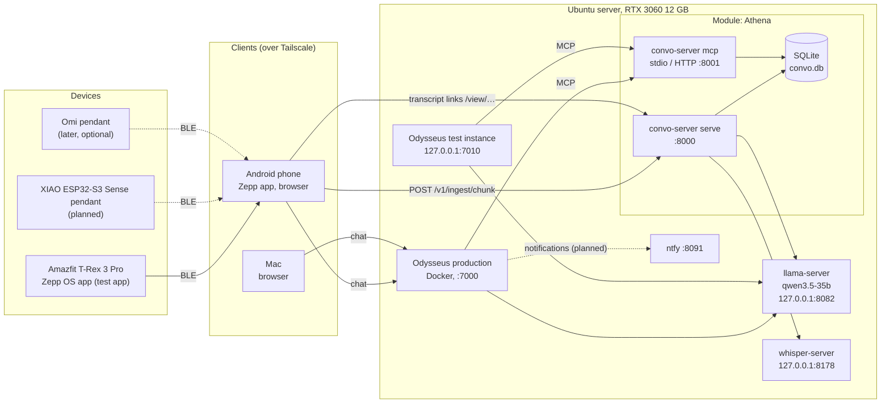

# Architecture

Odysseus is the hub of a personal, fully local AI system. Everything below runs on the
owner's network; the only way in from outside the house is Tailscale.

Dotted lines are planned. Development and testing happen in a cloud sandbox that runs the
same services on CPU with small models ([sandbox.md](sandbox.md)); this diagram is the
owner's server.

## Pieces

- **Hub (Odysseus):** the one chat and agent UI. Holds chat sessions, presets and its own
  settings. Knows nothing about module storage; it only calls module MCP tools.
- **Modules:** separate repos and programs that own their data
  ([modules.md](modules.md)). Today: Athena
  ([modules/odysseus-sound.md](modules/odysseus-sound.md)).
- **Devices:** belong to modules. Athena's devices record audio and upload it
  through the phone.
- **Local models:** one llama-server (OpenAI-compatible) and one whisper-server, shared by
  the hub and modules. No cloud model in any data path.
- **Network:** one Ubuntu machine. The Android phone and the Mac reach it over Tailscale.
  Target is Tailscale-only access with services bound to loopback, the Docker bridge or
  the Tailscale interface; while testing, some services are still open on the LAN
  (Athena `PROGRESS.md`, item 9b).

## Services and ports

| Service | Address | Status | Notes |
|---|---|---|---|
| llama-server (`qwen3.5-35b`, OpenAI-compatible, no auth) | `127.0.0.1:8082` | running | shared by both Odysseus instances and Athena |
| whisper-server (whisper.cpp) | `127.0.0.1:8178` | running; can be the user service `barvis-sound-whisper` (`BARVIS_SOUND_WHISPER_CMD`) | used by Athena |
| Athena API + worker (`convo-server serve`) | port 8000 | running (test server); user service `barvis-sound` once `odysseus-deploy` is set up | ingestion, read API, `/view/` transcript links |
| Athena MCP over HTTP (`convo-server mcp --http`) | `CONVO_MCP_HOST:CONVO_MCP_PORT`, default `127.0.0.1:8001` | user service `barvis-sound-mcp` once `odysseus-deploy` is set up | stdio (`convo-server mcp`) needs no port |
| Odysseus production (Docker, image `odysseus-fork:<commit>`; was upstream Odysseus until 2026-10-18) | port 7000, `~/models/odysseus` | running | the owner deploys it, and the modules, with `scripts/fork_deploy.sh` ([deploy.md](deploy.md)); agents never run anything on it |
| Odysseus isolated test instance | `127.0.0.1:7010` | running on demand (`~/.hermes/cache/scratch/barvis-run.sh`) | use for all tests and evals |
| Odysseus ChromaDB | port 8100 | part of production's Compose stack | must not be reachable from outside |
| ntfy | port 8091 | part of production's Compose stack; status not verified | Odysseus notifications planned |
| Embeddings llama-server (`--embeddings`) | e.g. `127.0.0.1:8083` | planned, optional | `CONVO_EMBED_BASE_URL` in Athena |
| Hermes Agent | — | installed | used by the Athena eval as a comparison frontend |

## Devices

| Device | Module | Status |
|---|---|---|
| Amazfit T-Rex 3 Pro (Zepp OS 5 Mini Program, 30 s Opus chunks, phone uploads) | Athena | test app built; waiting for the owner's on-watch test |
| Seeed XIAO ESP32-S3 Sense pendant (BLE → Android → server) | Athena | planned; plan in Athena `docs/xiao-esp32s3-sense-plan.md` |
| Omi pendant (BLE relay, no Omi cloud) | Athena | later, only if the XIAO falls short |
| Android phone | clients, relay | in use (Zepp app side service uploads chunks) |
| Mac | client | in use |
